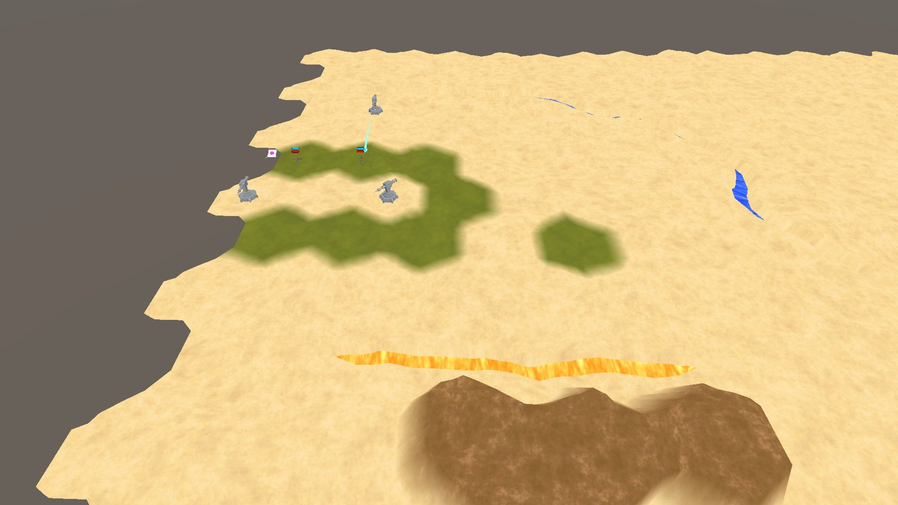
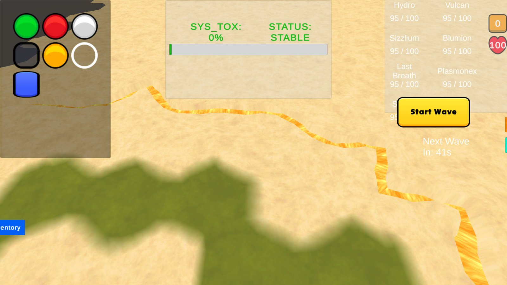
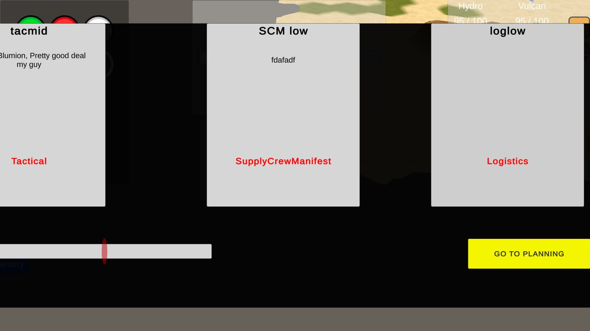
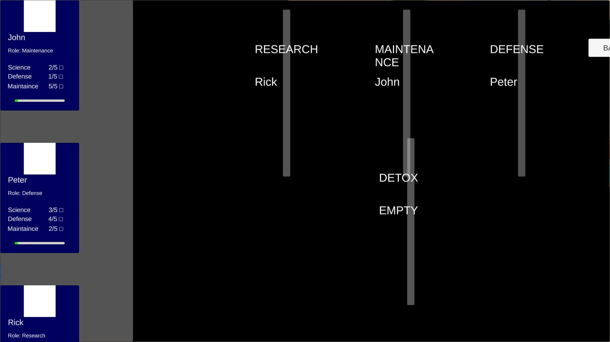

# ArcaneTD

A roguelike tower defence on a hex grid with a bio-punk plague-doctor theme. Every power spike has a price: pollution, a stressed crew, and a black-market Middleman who sells you out.

**Status:** work in progress. The systems below are implemented, but the interface and art are still placeholders. The screenshots show the current state.

> This repository is a showcase. The source code is kept private for now. If you would like to see code, get in touch.

## The idea

Most tower defence games reward building more. ArcaneTD makes every decision cost something.

- Turning a tower elemental needs a blueprint card and a retrofit, so timing matters.
- Refusing a risky card from the Middleman means he sells it to the enemy.
- Strong towers pollute the base, and an overworked crew performs worse.

## What is built

- **Design first.** I wrote the full game design document, then implemented the game from it.
- **Hex-grid maps** based on the Catlike Coding hex map tutorial, extended with liquid sources (Vulcanex, Hydronium) and ores that towers react to.
- **Towers.** Six attack behaviours (single target, splash, cone, pierce, mortar, all-around) on three base types, each with seven elemental variants and three upgrade tiers. Four support towers: Spotter, Deceiver, Extraction Beacon and Attacher.
- **Enemies.** Seven enemy classes and twelve named designs. Camouflaged enemies need a Spotter, disruptors slow or lock down towers, decoys split on death, thieves drain your elements, and every enemy has an elemental weakness.
- **Two ways to win.** Survive every wave for an Attrition win, or push the Research Lab to its top tier before the waves run out for a Turbo win. The win type decides what you get afterwards.
- **Toxicity.** Elemental towers add pollution every time they fire. At Critical, towers misfire. At Meltdown, tiles get contaminated. At Rapture, tanks are drained and the whole crew takes a stress hit.
- **The Middleman.** Between waves he offers cards in five types and three tiers. His loyalty runs from 0 to 100 and sets how good and how expensive the offers are.
- **Crew management.** Scientists rated 1 to 5 stars in science, maintenance and defence, with work slots and a rest slot. Stress and burnout lower performance, and an auto-assign finds the best placement.
- **Meta progression.** A campaign map with level prerequisites, XP and a skill tree, a permanent unlock codex, and save/load.

## Screenshots

| | |
|---|---|
|  |  |
| A Vulcanex lava source on the map. | The Middleman draft. Card names and text are test data. |
|  | [Video: a Field Retrofit (8 s)](media/field-retrofit.mp4) |
| Crew management: ratings, work slots and a detox slot. | The retrofit panel uses placeholder art. |

## By the numbers

- 156 C# scripts, about 16,000 lines of code
- 4 support towers, 7 enemy classes, 7 elements, 5 card types

## Tech

Unity 3D (URP), C#, ScriptableObjects, DOTween. Built solo as designer and developer.
